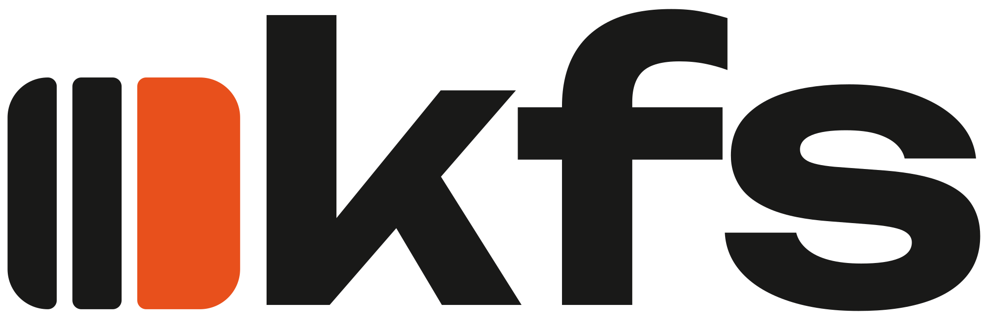
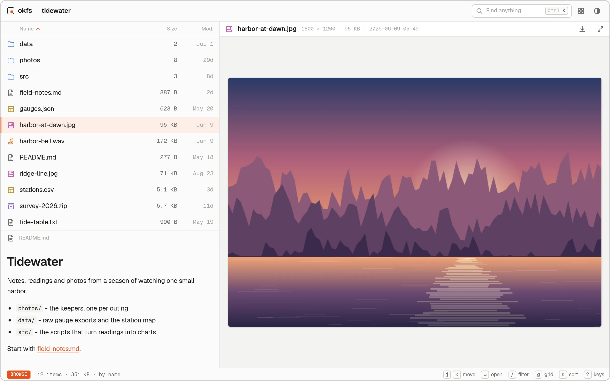
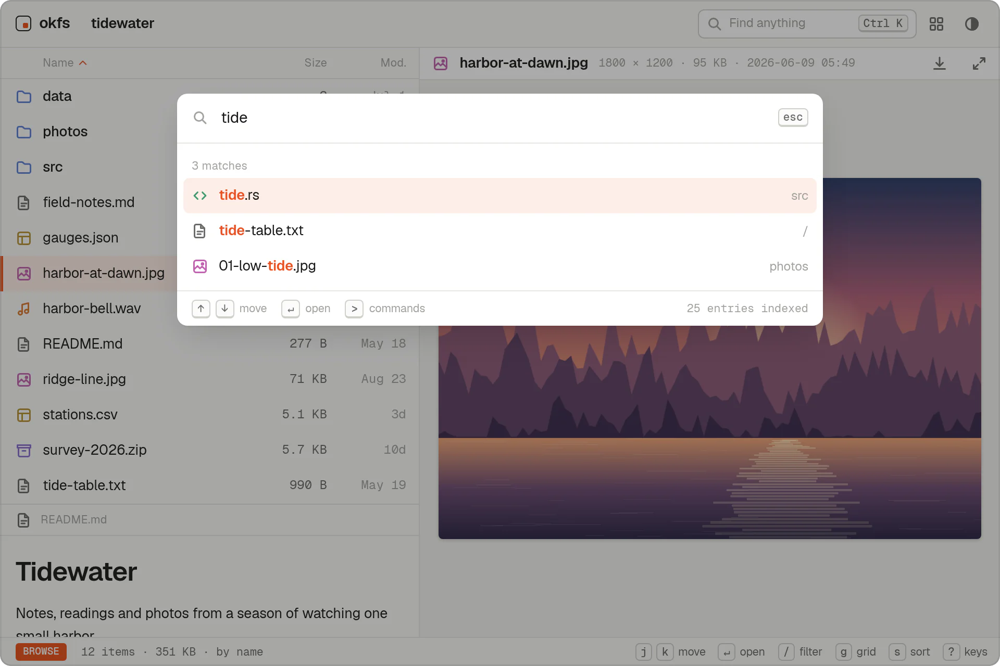

<h1 align="center">
  <picture><source media="(prefers-color-scheme: dark)" srcset="docs/logo/okfs-dark.svg"></picture>
</h1>

<p align="center">An open-source web file browser in one binary: run it in a folder and browse every file in your browser, with previews and instant search.</p>

<p align="center"><a href="https://okfs.jrnxf.co/demo/">Try it in your browser</a> · <a href="https://okfs.jrnxf.co">okfs.jrnxf.co</a></p>

<p align="center">
  <picture><source media="(prefers-color-scheme: dark)" srcset="docs/screenshots/hero-dark.webp"></picture>
</p>

okfs ("ok file server") serves a folder as a keyboard-driven web file browser. The page is compiled into the binary and loads nothing from another site: a dense list, a preview of whatever is under the cursor, and a search of every name in the tree.

## Install

```sh
brew install jrnxf/tap/okfs     # macOS or Linux
nix run github:jrnxf/okfs       # or run it once with nix
docker run -p 8080:8080 -v "$PWD:/srv:ro" ghcr.io/jrnxf/okfs
cargo install --git https://github.com/jrnxf/okfs
```

Release archives for Linux, macOS and Windows are on the [releases page](https://github.com/jrnxf/okfs/releases). See [docs/install.md](docs/install.md) for them, Docker, building from source and platform notes.

## Use

```sh
okfs ~/photos               # serve a folder and open it in the browser
okfs --bind 0.0.0.0 --qr    # let a phone on the same network in, with a QR code to scan
okfs --help                 # every flag, with examples
```

okfs listens on `127.0.0.1:8080` and opens the page. Press `?` in it for the keys, and `Ctrl K` or `Cmd K` to find any file in the tree. Every flag also reads from an `OKFS_*` environment variable. See [docs/usage.md](docs/usage.md) for the flags, keys and stable addresses.

## Features

- Previews for images, video, audio, PDF, Markdown, source code, CSV, JSON, zip files and HTML pages. Hold `j` and each file shows as the cursor passes it.
- A palette that finds any file in the whole tree at once, from an index kept in memory.
- Columns that show what is inside the folder under the cursor. The page follows the folder as files change, with no reload.
- Eleven built-in themes, each one CSS file: [themes](docs/themes.md).
- Read only unless you turn writes on: `--allow-upload`, `--allow-edit` and `--allow-delete` are separate flags. A delete goes to a Trash for 30 days, with Undo. There are no accounts. [Writing](docs/writing.md).
- Loopback by default. Beyond it, only a link with a key that okfs prints gets in, and `--tls-cert` serves HTTPS. [Network](docs/network.md).

<p align="center">
  <picture><source media="(prefers-color-scheme: dark)" srcset="docs/screenshots/palette-dark.webp"></picture>
</p>

## Docs

- [Install](docs/install.md): every way to get okfs
- [Using okfs](docs/usage.md): flags, environment, keys, addresses, big folders
- [Network](docs/network.md): the key, HTTPS, proxies, systemd and launchd
- [Writing](docs/writing.md): uploading, editing, deleting and the Trash
- [Themes](docs/themes.md) and [what is safe to serve](docs/security.md)
- [How okfs compares](docs/comparison.md) and [developing it](docs/development.md)

## License

okfs is released under the MIT License. See `LICENSE`. Bundled fonts and other work are credited in `THIRD_PARTY.md`.
