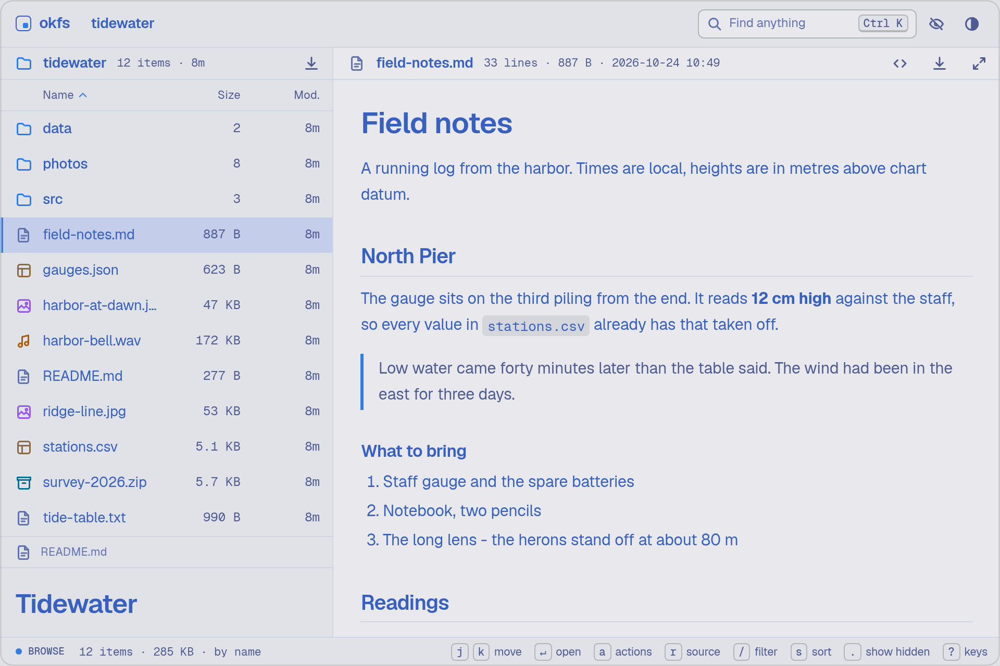
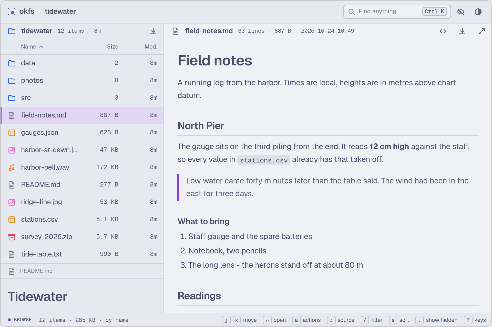
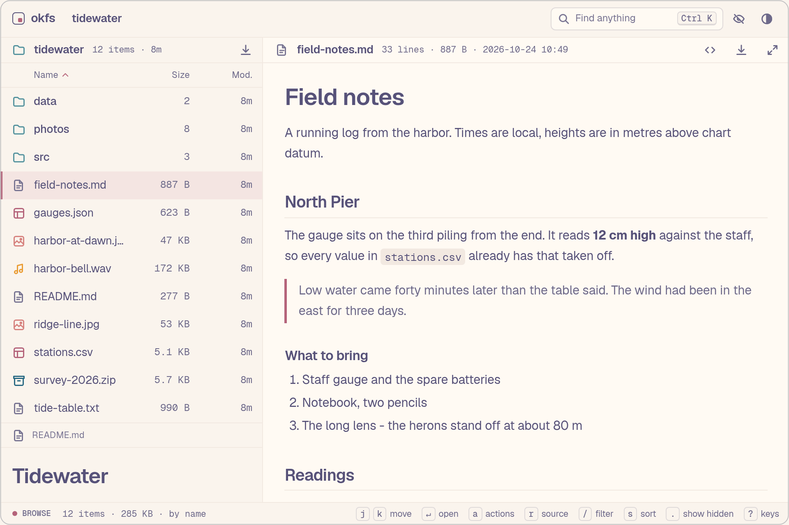
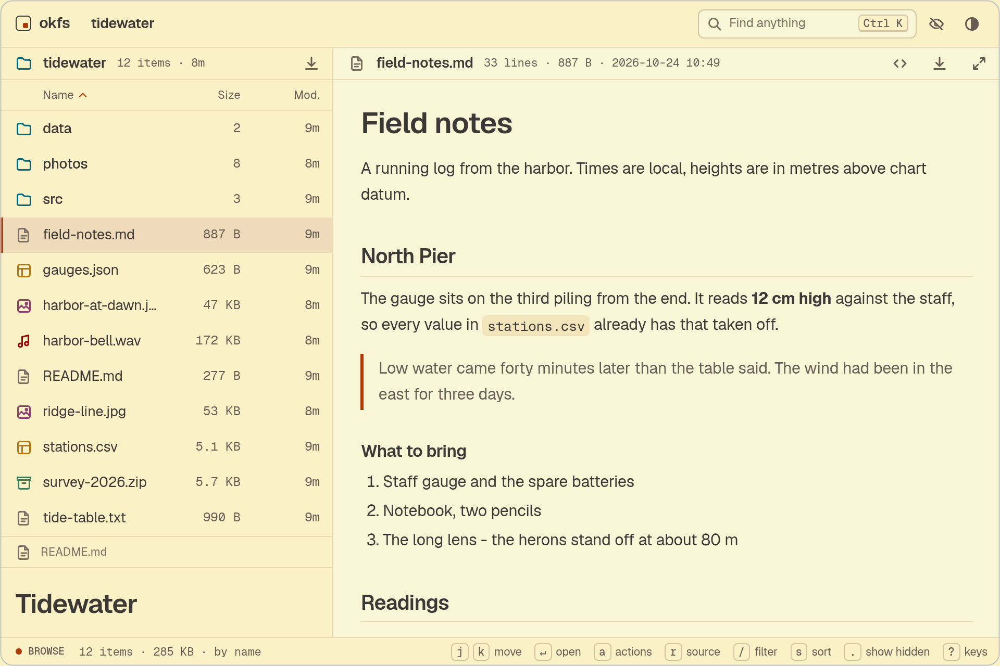
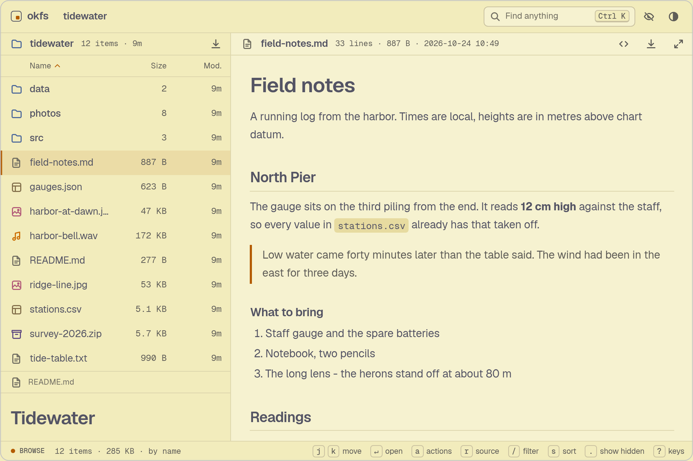
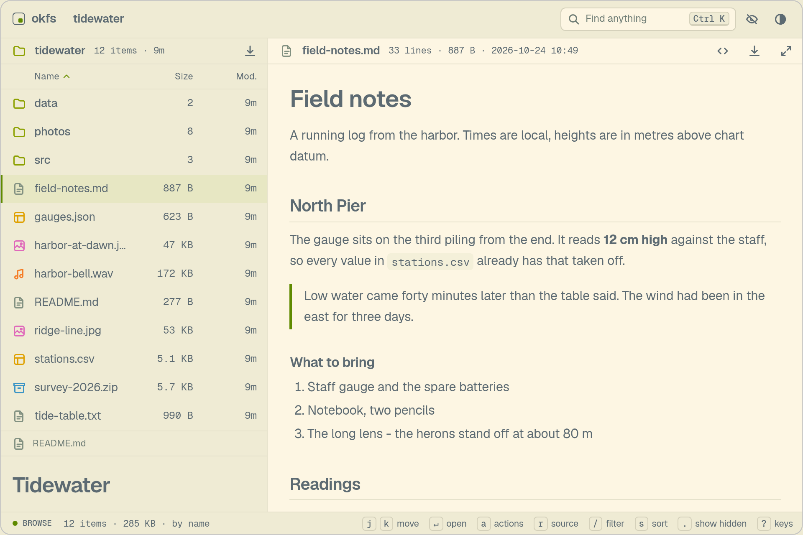
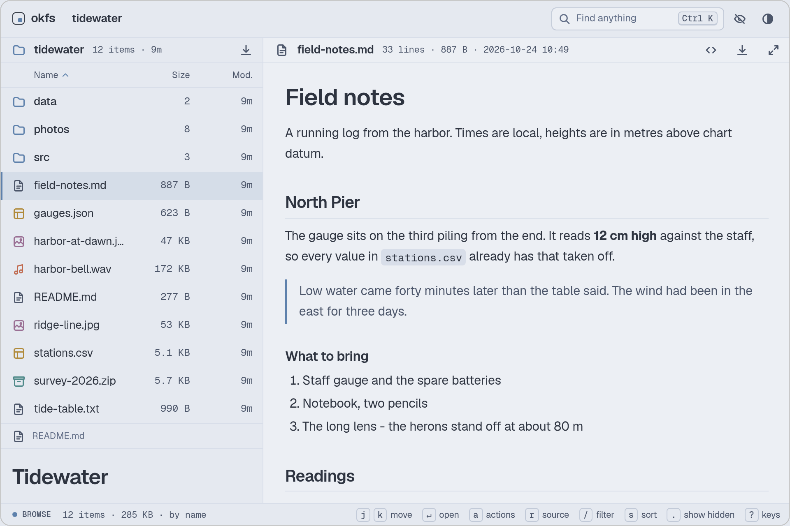
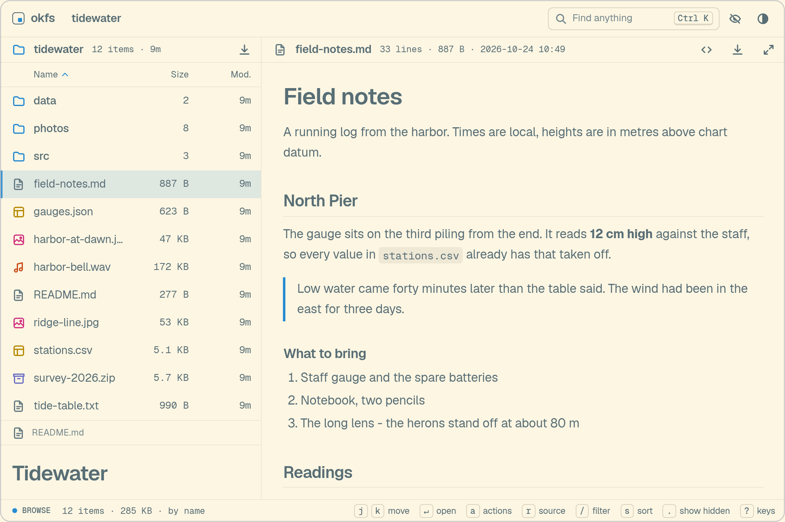
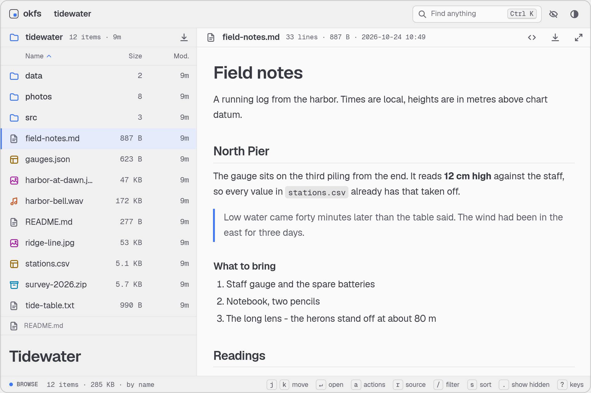
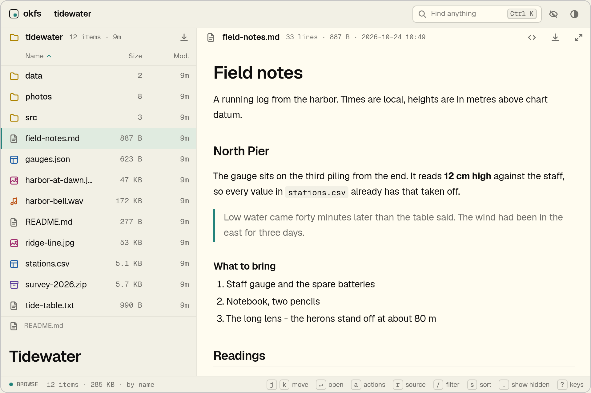

<h1 align="center">
  <picture><source media="(prefers-color-scheme: dark)" srcset="docs/logo/okfs-dark.svg"></picture>
</h1>

<p align="center">An open-source web file browser in one binary: run it in a folder and browse every file in your browser, with previews and instant search.</p>

<p align="center"><a href="https://okfs.jrnxf.co/demo/">Try it in your browser</a> · <a href="https://okfs.jrnxf.co">okfs.jrnxf.co</a></p>

<p align="center">
  <picture><source media="(prefers-color-scheme: dark)" srcset="docs/screenshots/hero-dark.webp"></picture>
</p>

okfs ("ok file server") is an open-source web file browser in one binary. The page is compiled into it, so there is nothing to install beside it, and the page loads nothing from another site while it runs. Run it in a folder and the whole tree is a keyboard-driven browser: a dense list, a preview of whatever is under the cursor, and a search of every name in the tree.

## Install

With Homebrew, on macOS or Linux:

```sh
brew install jrnxf/tap/okfs
```

With nix, run it without installing anything, or put it on your `PATH`:

```sh
nix run github:jrnxf/okfs -- ~/photos   # run it once
nix profile install github:jrnxf/okfs   # or install it
```

`nix profile upgrade okfs` brings an installed copy up to date.

Without nix, download a release. okfs has none yet: the first is `v0.1.0-pre.1`. Until v0.1.0, releases are pre-releases, tagged `v0.1.0-pre.N`, and `gh release download` with no tag takes only a full release, so ask for the newest one by name.

Each release has an archive for Linux (x86-64 and arm64) and macOS (Apple silicon and Intel), named `okfs-<version>-<target>.tar.gz`, with a `.sha256` beside it. The targets are `x86_64-unknown-linux-musl`, `aarch64-unknown-linux-musl`, `aarch64-apple-darwin` and `x86_64-apple-darwin`. The Linux binaries are static, so they run on any distribution whatever its C library. An archive holds the `okfs` binary, its bash, zsh and fish completions under `completions/` and the manual page `okfs.1`.

```sh
tag=$(gh release list --repo jrnxf/okfs --limit 1 --json tagName --jq '.[0].tagName')
gh release download "$tag" --repo jrnxf/okfs --pattern '*-aarch64-apple-darwin.tar.gz*'
shasum -a 256 -c okfs-*-aarch64-apple-darwin.tar.gz.sha256
tar -xzf okfs-*-aarch64-apple-darwin.tar.gz
./okfs-*-aarch64-apple-darwin/okfs --version
```

With Docker, mount the folder to serve at `/srv`:

```sh
docker run -p 8080:8080 -v "$PWD:/srv:ro" ghcr.io/jrnxf/okfs
```

The image is the release's static binary and nothing else, for amd64 and arm64. It listens on every address, so it asks for the key. Inside a container okfs prints the container's own addresses, such as `172.17.0.2`, which a browser on the host cannot open: keep the `?key=...` part of the link and put the host's address in front of it, such as `http://192.168.1.20:8080/?key=...`. A plain IP address needs no `--allow-host`. The image runs as an unprivileged user, so to use a write flag (`--allow-upload` and the others), add `--user "$(id -u):$(id -g)"` and drop `:ro`. Anything after the image name is an okfs argument, and the `OKFS_*` variables below set its options. The image sets `OKFS_BIND`, `OKFS_PORT` (8080), `OKFS_NO_OPEN` and `OKFS_PATH` (`/srv`) itself: set one of them with `-e` to change it, and publish the new port with `-p`. The tags are the version, such as `0.1.0`, and `latest`, which follows full releases only. The thumbnail cache is the volume `/cache`.

With a Rust toolchain, `cargo install okfs` builds it from crates.io (from v0.1.0; until then use the git command below). The crate carries the built page, so it needs no bun.

Or build it from the repository. You need a Rust toolchain and [bun](https://bun.sh): bun builds the page while cargo builds the binary.

```sh
cargo install --git https://github.com/jrnxf/okfs
```

To build from a checkout without installing, the nix dev shell has both tools:

```sh
nix develop
cargo build --release    # the binary is target/release/okfs
```

The engine that draws the first page of a PDF is about 6 MB of the binary. `cargo build --release --no-default-features` leaves it out: PDFs then open in the browser's viewer alone. Every other preview is the same.

Platform notes:

- There is no Windows build yet. The code has not been run there.
- On a Mac, a binary downloaded with a browser is quarantined, and Gatekeeper refuses to open it because okfs is not signed. Download it with `gh` or `curl` as above, which leaves no quarantine mark, or clear the mark with `xattr -d com.apple.quarantine okfs`.
- Watching a folder for changes uses inotify on Linux and FSEvents on a Mac. On a network share, where a watcher does not see what other machines change, use `--rescan` (see [A big folder](#a-big-folder)).
- Shell completions: `okfs completions zsh` (or `bash`, `fish`) prints them. The release archive has them as files, and `okfs.1` is the manual page.

## Quick start

```sh
okfs ~/photos               # serve a folder and open it in the browser
okfs --bind 0.0.0.0 --qr    # let a phone on the same network in, with a QR code to scan
okfs --help                 # every flag, with examples
```

okfs listens on `127.0.0.1:8080` and opens the page. Press `?` in it for the keys, and `Ctrl K` or `Cmd K` to find any file in the tree.

## What it does

- A dense list on the left, and beside it what is under the cursor: hold `j` and every file shows as the cursor passes it.
- Previews for images, video, audio, PDF, Markdown, source code, CSV, JSON, zip files and HTML pages.
- A palette that finds any file in the whole tree at once, from an index kept in memory.
- Columns that show what is inside the folder under the cursor, and the page follows the folder as files are added, removed or rewritten, with no reload.
- Eleven built-in themes, light and dark, each one CSS file, among them Tokyo Night, Catppuccin, Rosé Pine, Gruvbox and Nord.
- Read only unless you turn writes on. Uploading, editing and deleting are each behind a flag of their own: `--allow-upload`, `--allow-edit`, `--allow-delete`. A delete goes to a Trash for 30 days, with Undo. There are no accounts.
- Loopback by default. Beyond it, only a link with a key that okfs prints gets in (see [Letting other machines in](#letting-other-machines-in)).

<p align="center">
  <picture><source media="(prefers-color-scheme: dark)" srcset="docs/screenshots/palette-dark.webp"></picture>
</p>

## Why okfs

okfs is for looking at a folder. Its previews, columns and search are made for flipping through many files quickly with the keyboard, and its defaults are safe: loopback only, read only, dotfiles hidden, a key beyond loopback.

It does less than the tools that manage files, on purpose. It reads until you turn writes on, and it has no accounts. For uploads of very large files that pick up where a dropped connection left them, use copyparty. For a file manager with users, use File Browser Quantum. File Browser itself was archived in September 2026.

| | okfs | `python -m http.server` | miniserve | dufs | copyparty |
| --- | --- | --- | --- | --- | --- |
| Default address | loopback only | all interfaces | all interfaces | all interfaces | all interfaces |
| Beyond loopback | secret link | none | basic auth, optional | basic or digest auth, optional | accounts |
| Writes | none unless turned on: upload, edit and delete, each behind a flag | none | upload, optional | upload, edit, move and delete, each optional | upload, per account |
| Previews | images, video, audio, PDF, Markdown, code, CSV, JSON, zip, HTML | none | none | none | thumbnails, audio spectrograms |
| Search of the whole tree | instant, in memory | none | none | yes | yes, indexed |
| Live updates | yes | none | none | none | not checked |
| TLS | yes, optional | since Python 3.14 | yes | yes | yes |

This is how each tool read on 2026-10-21, from its documentation. Check the project you are comparing before you rely on a cell.

## The page

These are the details behind the list above.

- A dense list on the left, and beside it what is under the cursor: a file is shown as soon as the cursor is on it, in the same pane. Hold `j` to flip through a folder: every file shows as the cursor passes it.
- A page of 256 KB or more, a PDF's viewer and a player wait until the key is let go, unless they were loaded ahead: the next few pages and PDFs past the cursor are, in hidden frames, so a page may run its scripts before you look at it. A PDF shows a picture of its first page meanwhile, and a video one frame of itself when it was reached in time, so a held key flips through those too. A phone has no space bar: there a tap opens the file over the list, with previous and next in a bar at its foot and download and delete behind a `...` button.
- Markdown opens rendered, an HTML page opens as the page, and a CSV table opens as a table, from the list and from a link to the file alike; `r` flips each to its source, as it is written, colored and never run. An SVG drawing and JSON open as their source, and `r` flips them to what is made from them. The choice holds for the files of that kind that follow, until you flip it back or leave the page. Pictures, PDFs, video and audio have no source and are always shown as themselves. There is a button for it beside the file's name. The source of Markdown, an HTML page, a text and a log wraps at the edge of the pane, with wrapped lines hanging from the line number; source code never wraps. `w` turns wrapping off and on, and the choice holds for the files of that kind that follow.
- A folder under the cursor shows what is in it: its list in a column as wide as the main list, then the inside of its first entry in the next, or of the entry you were on when you last left it, as far down as the window has room. A folder there gets a column of its own, and a file is shown as it would be under the cursor, so a folder that holds one file shows that file. The pointer leads them too: the entry it is on in a column is the one the columns after it go into, a folder or a file, and a key that moves the cursor takes over until the pointer moves again. Going into the folder puts the cursor on the entry its column leads on to, whatever the sort. The window is cut into four equal parts, three under 1,200 px and two under 900 px, and the main list is one of them. Every column comes in one answer, so a held key shows them as it passes. They hold names, sizes and times, and no file is read for them. The main list has the same bar over it as each column, so a folder's rows sit at the same height in every slot, and the columns slide sideways into their new slots as you go in or out, with the cursor's highlight travelling from the row it was on to the row it lands on, so the eye can follow it.
- Hidden files stay out of the way: dotfiles, and the folders left out of the search, such as `node_modules` and what a `.gitignore` names (see [A big folder](#a-big-folder)). `.`, or the eye button at the top, shows them and hides them again, and the browser remembers the choice. The counts beside each folder are of what is shown, so a folder says how many entries you will find in it, and the bar at the foot says how many are hidden. The search hides the same ones.
- A palette (`Ctrl K` or `Cmd K`) that finds any file in the whole tree, lists the most recently changed files before you type, and runs commands when you start with `>`. `Ctrl Enter` or `Cmd Enter`, or the row under its matches, lists every match in place of the folder: ranked, with the folder each is in, sortable by name, folder, size and time, and loaded a page at a time as you scroll. The query is in the address (`?find=`), so back, a reload and a shared link all work, and a folder or a file opened from the matches leads back to them.
- The page follows the folder. A file that is added, removed, renamed or rewritten shows at once, and so does an open preview, with no reload.

## Use

```sh
okfs                        # serve this folder at http://127.0.0.1:8080/
okfs ~/photos --port 9000   # another folder, another port
okfs --bind 0.0.0.0         # let other machines on the network in, with a key in the link
okfs --bind 0.0.0.0 --qr    # and print a QR code a phone can scan to open it
```

A folder's `README.md` is shown under its listing.

### Options from the environment

Every option can also come from an environment variable named for it: `OKFS_PORT` for `--port`, `OKFS_BIND`, `OKFS_THEME`, `OKFS_ALLOW_UPLOAD`, `OKFS_RESCAN`, and the folder itself as `OKFS_PATH`. `okfs --help` shows each one as `[env: OKFS_PORT=]`. That is how a Docker Compose file or a systemd unit configures okfs without a command line to rewrite. A flag on the command line beats the variable. A switch takes `true` or `false`: `OKFS_ALLOW_UPLOAD=true`. `OKFS_ALLOW_HOST` takes names separated by commas, and `--allow-host a,b` on the command line now means two names too. A switch also accepts `1`, `0`, `yes`, `no`, `on` and `off`, and an empty one counts as off, so an unset `${VAR}` in a Compose file does no harm. `--no-key` with `--key`, and `--no-trash` with `--trash-days`, are refused when either one comes from a variable and both are on. `--key` is the one that is not `OKFS_KEY`, which would read as the key's value: `--key` is `OKFS_ASK_KEY`, and `--no-key` is `OKFS_NO_KEY`.

```yaml
services:
  okfs:
    image: ghcr.io/jrnxf/okfs
    ports: ["8080:8080"]
    volumes: ["/srv/photos:/srv:ro"]
    environment:
      OKFS_THEME: gruvbox
      OKFS_TITLE: Photos
```

The page follows changes through a watcher on the folder. Where okfs cannot set one up, it says so when it starts and reads the whole folder again on a timer: every 30 seconds, or 20 times as long as one read of it takes when that is longer, so a tree that takes minutes to read is not read over and over. The page catches up at that pace. Something reached through a symbolic link is not followed as it changes: it catches up when the page is reloaded or shown again.

With `--rescan`, okfs sets up no watcher and reads the whole folder again on a timer you choose: `--rescan 6h`. That suits a tree too big to watch, and a network share, where a watcher does not see what other machines change. A folder's listing is always read from the disk when it is opened, so only what comes from the index waits for the next read: the search, its list of recent files, and how many entries a folder holds.

<details>
<summary>All flags</summary>

| Flag | What it does |
| --- | --- |
| `[PATH]` | The folder to serve. Default: the current folder. |
| `-b`, `--bind <ADDR>` | Address to listen on: an IP address or `localhost`. Default `127.0.0.1`. Beyond loopback, a [key](#letting-other-machines-in) is asked for. |
| `-p`, `--port <PORT>` | Port to listen on, `0` for any free one. Without it, `8080`, or the next free port after it. |
| `--qr` | Print a QR code for the first address another device can use, in a terminal. It carries the key. Off by default. |
| `--no-open` | Do not open the browser. It opens by default in a terminal, never as a service and never over SSH. |
| `--index <FILE>` | Open a folder that holds a file of this name as that page: `--index index.html`. Off by default. See below. |
| `--theme <NAME\|FILE>` | Theme a new visitor starts in: a built-in name or a theme file. |
| `--header <FILE.md>` | A Markdown note shown above every folder. |
| `--title <TEXT>` | Name shown in the corner and the browser tab. Default `okfs`. |
| `--accent <COLOR>` | Accent color in every theme, as hex: `"#2d6a4f"`. |
| `-H`, `--hidden` | Serve dotfiles, and show hidden files to a browser that has made no choice with `.`. Without it, dotfiles are never sent, and `.` shows only the folders left out of the search. |
| `--key` | Ask for the key on a loopback address too, as behind a tunnel that anyone can reach. Any write flag does the same. |
| `--no-key` | Let in anyone who reaches an address beyond loopback, with no key. For a proxy that signs people in itself. See [Letting other machines in](#letting-other-machines-in). |
| `--allow-host <NAME>` | Also answer to this host name. Repeatable. See below. |
| `--tls-cert <FILE>` | Serve https with this certificate, in PEM. Needs `--tls-key`. See [HTTPS](#https). |
| `--tls-key <FILE>` | The private key of the `--tls-cert` certificate, in PEM. Needs `--tls-cert`. |
| `--allow-upload` | Let anyone who can reach the address add files and folders. A file never replaces one that is there. Off by default. See [Uploading and editing](#uploading-and-editing). |
| `--allow-edit` | Let anyone who can reach the address change the files that are there, and rename and move them. Off by default. See [Uploading and editing](#uploading-and-editing). |
| `--allow-delete` | Let anyone who can reach the address delete files and folders. A delete goes to the Trash first. Off by default. See [Deleting](#deleting). |
| `--trash-days <DAYS>` | How long the Trash keeps what is deleted before it goes for good. 30 by default. |
| `--no-trash` | Delete for good at once, after asking, with no Trash and no undo. |
| `--max-upload <SIZE>` | The largest file an upload or a save may be: `500M`, `4G`. No limit by default. |
| `--rescan <EVERY>` | Read the whole tree again this often instead of watching it for changes: `90s`, `30m`, `6h`, `1d`, `1h30m`. Off by default. See [A big folder](#a-big-folder). |

</details>
### Keys

| Key | Does |
| --- | --- |
| `j` `k`, arrows | Move down and up |
| `Enter` | Open the folder, or give the file the full width |
| `r` | Rendered or source, for a file that has both: HTML, Markdown, SVG, CSV, JSON |
| `w` | Wrap long lines or not, for prose shown as its source: Markdown, HTML, text, logs |
| `Backspace`, `-` | Up one folder |
| `h` `l`, left and right arrows | Out of a folder and into one. With a file open, left goes back to the list it was opened from. |
| `Home` `End` | First and last in the folder |
| `PageDown` `PageUp` | Down and up by a page |
| `y` | Copy a link to the file or folder under the cursor, with the key if there is one |
| `/` | Filter this folder |
| `Ctrl K`, `Cmd K` | Find anything in the tree. Start with `>` for commands. |
| `s` | Change the sort |
| `t` | Light or dark |
| `.` | Show hidden files, or hide them again |
| `Esc` | Let the selection go, or close the open file or the filter. In a folder entered from the matches, go back to them. |
| `a`, `Shift F10`, the menu key | The menu of the row under the cursor, or of the selection: the same menu a right click opens |
| `Space` | Select the row and step down. With `Shift`, select from the anchor to the row. |
| `Shift` and the arrows | Select from the anchor, growing and shrinking as `Shift` and a click do |
| `Ctrl A`, `Cmd A` | Select every row of the folder |
| `Y` | Copy the path of the row, or of every selected row |
| `e` | Edit the text file. Only with `--allow-edit`. |
| `F2`, `Shift R` | Rename in place. Only with `--allow-edit`. |
| `m` | Move to a folder you pick. Only with `--allow-edit`. |
| `c` | Copy to a folder you pick. Only with `--allow-upload`. |
| `u` | Upload files into this folder. Only with `--allow-upload`. |
| `n`, `Shift N` | Make a new file or folder in this folder and name it in place. Only with `--allow-upload`. |
| `Shift D` | Move the file or folder, or the selection, to the Trash. Only with `--allow-delete`. |
| `Ctrl Z`, `Cmd Z` | Undo the last move to the Trash, rename, move or copy, while its note is up |
| `?` | Show the keys |
### Addresses you can rely on

These addresses are stable. Scripts, bookmarks and `curl` can use them:

| Address | Gives |
| --- | --- |
| `/<path>` | In a browser, the page showing that file or folder. For a program that does not ask for HTML, such as `curl` or `wget`, the file itself. |
| `/raw/<path>` | The file's bytes, with ranges. |
| `/zip/<path>` | A folder as a zip stream. |
| `/?find=<query>` | The page with the search for that query open. |

```sh
curl -O http://127.0.0.1:8080/notes/todo.md
curl -o photos.zip http://127.0.0.1:8080/zip/photos
```

Everything under `/api/` is okfs's own channel to its page. It may change in any release, so do not build on it.

### A folder that is a small site

A folder is shown as its listing. With `--index`, a folder that holds a file of that name opens as that page, at the folder's own address, so a link to the folder is a link to the site:

```sh
okfs --index index.html
```

The page is shown the way any HTML file is: full width under the thin bar, sandboxed. A link in it to another folder opens that folder's index page too. Closing it shows the folder's listing with the page under the cursor. A folder of that name is not an index page. Neither is a file okfs does not serve: a dotfile without `--hidden`, or a link that leaves the served folder.

### A big folder

`Ctrl K` searches an index of every name in the tree, kept in memory. okfs reads the tree once when it starts, and the search works on what it has found so far while that goes on: the count in its footer climbs until it says the tree is indexed.

Some folders are left out of that index, so that a home folder does not spend minutes and hundreds of megabytes on `node_modules` and caches. A folder that is left out is a hidden file in its folder's listing, as a dotfile is: `.` shows it there, and it opens like any other at its address. What is inside it is not searched, not held in memory, and not followed by the watcher beyond telling an open page that something in it changed. These are left out:

- Folders named `node_modules`, `.git`, `.cache`, `.npm` or `.Trash`, wherever they are.
- `Library`, in the served folder, when it is a Mac's home folder.
- What the `.gitignore` files inside the served folder name, each for its own folder and below. A folder is left out when a rule names it as a folder (`build/`, `dist`); files that are named are searched as before. okfs reads only the files in the served folder and below, not those above it, `.git/info/exclude`, or your global ignore file.
- What the file `.okfsignore` in the served folder names. It is written the way a `.gitignore` is, with paths from the served folder, and is read after the `.gitignore` there, so a `!` line in it can let a folder back in.

```gitignore
# .okfsignore in the served folder
photos/raw
backups/
!dist
```

A change to any of these files is read when it happens. The built-in names are always left out. The watcher still looks at the whole tree on Linux: it takes one inotify watch per folder, left out or not, so a very large tree can reach `fs.inotify.max_user_watches`. okfs then reads the folder again on a timer, as described above. To choose that timer, or to spare a large tree the watches, pass `--rescan`:

```sh
okfs --rescan 6h /mnt/archive
```

Each of those reads also removes the cached thumbnails that have not been used for 30 days, which otherwise happens only when okfs starts.
### Letting other machines in

okfs listens on the loopback address, which only the machine it runs on can reach. `--bind 0.0.0.0` lets the network in, and from then on okfs asks for a key. It makes a random one each time it starts, and prints every address with the key on it:

```text
  at       http://192.168.1.20:8080/?key=...
  key      on: anyone with one of these links can read every file shown
```

A request without the key is refused. A browser that opens the link is given a cookie that holds the key, and the key is taken out of the address bar; a program such as `curl` adds `?key=...` to each request. `--qr` prints a code for the same link, so a phone opens the folder by scanning it. The key is new at every start, so an old link stops working when okfs restarts.

What the key does and does not do:

- It stops anyone who can reach the address but does not have the link. It does not stop anyone who can watch the traffic. Without a certificate okfs speaks plain HTTP, so on open Wi-Fi, or on a network whose password others know, a program that captures packets reads the key and then every file. Treat such a link as you would a password sent over plain HTTP. For anything beyond a network you trust, serve [HTTPS](#https) or put a TLS proxy in front (see [Behind a proxy or a tunnel](#behind-a-proxy-or-a-tunnel)).
- The cookie is `HttpOnly` and `SameSite=Strict`, which keeps scripts and other sites' pages from using it. A browser still sends a cookie to every port of the same host. Any other web service on the same machine, on any port, therefore receives the key from a browser that has opened okfs. Do not run okfs on a machine that also runs listeners you do not trust.
- On a machine with other users, another account can read the command that opens the browser. So the browser okfs opens itself gets a one-time `?once=` code in place of the key. The first request that brings the code trades it for the cookie, and a code no browser has used dies after 60 seconds.
- The key is not a login. Anyone who has the link has all of it: with a write flag, that includes changing and deleting.
- An HTML page in the preview is sandboxed in an origin of its own, and a browser sends no cookie with what it asks for. So while the key is on, the page is shown at an address that carries a pass to its own folder in place of the key. The pass lets in reading the files in that folder and the folders below it, so the page's images, stylesheets, scripts and links to its neighbours load. It lets in nothing else: no file above or beside that folder, no listing, no other route and no write. The page's scripts can read the pass, as they can its address, and could send it elsewhere: anyone who gets it can read that folder, until okfs restarts. The key itself is never put in a page's address. The same page opened directly under `/raw/` still sends no key, so there it cannot load its neighbours.

`--no-key` turns the key off. Use it only when something in front of okfs already decides who gets in, such as a proxy that signs people in, or on a network where everyone may read the folder. `--key` asks for the key on a loopback address too, for a tunnel that exposes it to anyone. `--allow-upload`, `--allow-edit` and `--allow-delete` each do the same, so that another account on the machine cannot change the folder. The browser okfs opens gets a one-time code, so on your own machine nothing looks different.

### HTTPS

Give okfs a certificate and its private key, both PEM files, and it serves https instead of http:

```sh
okfs --bind 0.0.0.0 --tls-cert cert.pem --tls-key key.pem
```

The two flags go together: one without the other is refused. Every address okfs prints starts with `https://`, and so do the `--qr` code and the link the browser opens with. The key, the one-time code and the host check work as they do over http, and the key's cookie is marked `Secure`. The port answers https alone: a browser that asks it for plain http gets no answer, so the key never crosses in the clear.

okfs does not make a certificate. Two ways to get one:

- [mkcert](https://github.com/FiloSottile/mkcert) makes one for the addresses you name, signed by a certificate authority of its own: `mkcert 192.168.1.20 localhost 127.0.0.1`. The browsers on the machine that ran `mkcert -install` trust it. A phone or another computer trusts it once you install mkcert's root certificate on it (`mkcert -CAROOT` says where it is). Until then they warn about it.
- A certificate for a name of your own, such as the one a reverse proxy or Let's Encrypt keeps for `files.example.com`. Point that name at the machine and pass `--allow-host files.example.com` too, as okfs answers only to [names it is given](#behind-a-proxy-or-a-tunnel).

okfs reads the files once, when it starts. Restart it after the certificate is renewed.

### Behind a proxy or a tunnel

On every address it listens on, okfs answers only to `localhost`, to plain addresses such as `127.0.0.1` or `192.168.1.20`, and to the names you give it with `--allow-host`. Any other name in a request's `Host` gets a refusal that names the flag to pass. This stops a hostile web page from reaching okfs by pointing a host name of its own at your machine, also when okfs listens on `0.0.0.0` and the machine it points at is another one on your network. If you put a proxy or a tunnel in front, name the host it uses:

```sh
okfs --allow-host files.example.com
```

A name of your own on the network, such as `my-laptop.local`, needs `--allow-host` too. A plain address always works, as `--bind 0.0.0.0` prints it.

The host check is not a password. A program other than a browser can send any name it likes, so okfs behind a proxy that asks people to sign in is still open to anything that can reach its own address directly. Keep that address where only the proxy can reach it: listen on loopback with the proxy on the same machine, or let a firewall through to okfs's port from the proxy alone. On loopback okfs asks for no key, unless a write flag is on. If okfs has to listen beyond loopback behind a proxy that signs people in, pass `--no-key`, or the proxy's users are asked for a key they do not have.

A proxy that ends TLS gives you https without `--tls-cert`, and okfs then marks its key cookie `Secure` when the proxy sends `X-Forwarded-Proto: https`. A tunnel such as Cloudflare Tunnel or Tailscale Funnel does the same job without a proxy of your own: run okfs on loopback, name the tunnel's host with `--allow-host`, and add `--key` unless the tunnel signs people in.

okfs cannot live under a path such as `example.com/files/`. Every address it uses starts at `/`, and there is no base-path option. Give it a host name of its own, such as `files.example.com`.

### Run it for good

okfs stops cleanly on SIGTERM as well as Ctrl-C, so a service manager can stop it. Run it on loopback, without opening a browser, and put the proxy in front.

#### systemd

`/etc/systemd/system/okfs.service`:

```ini
[Unit]
Description=okfs file browser
After=network.target

[Service]
ExecStart=/usr/local/bin/okfs --no-open --bind 127.0.0.1 --port 8080 --allow-host files.example.com /srv/files
DynamicUser=yes
ReadOnlyPaths=/srv/files
Environment=XDG_CACHE_HOME=/var/cache
CacheDirectory=okfs
NoNewPrivileges=yes
ProtectHome=yes
Restart=on-failure

[Install]
WantedBy=multi-user.target
```

`DynamicUser=yes` runs okfs as a user with no account, so the files in `/srv/files` must be readable by everyone. With a write flag, okfs has to be able to write there: use `ReadWritePaths=` in place of `ReadOnlyPaths=`, and a `User=` that owns the folder. `CacheDirectory=okfs` gives it `/var/cache/okfs` for thumbnails and PDF pictures, and `XDG_CACHE_HOME` points okfs there. Then:

```sh
sudo systemctl daemon-reload
sudo systemctl enable --now okfs
```

#### launchd

`~/Library/LaunchAgents/co.example.okfs.plist`:

```xml
<?xml version="1.0" encoding="UTF-8"?>
<!DOCTYPE plist PUBLIC "-//Apple//DTD PLIST 1.0//EN" "http://www.apple.com/DTDs/PropertyList-1.0.dtd">
<plist version="1.0">
<dict>
  <key>Label</key>
  <string>co.example.okfs</string>
  <key>ProgramArguments</key>
  <array>
    <string>/usr/local/bin/okfs</string>
    <string>--no-open</string>
    <string>--bind</string>
    <string>127.0.0.1</string>
    <string>--port</string>
    <string>8080</string>
    <string>/Users/user/files</string>
  </array>
  <key>RunAtLoad</key>
  <true/>
  <key>KeepAlive</key>
  <true/>
</dict>
</plist>
```

```sh
launchctl bootstrap gui/$(id -u) ~/Library/LaunchAgents/co.example.okfs.plist
```

A service on a Mac reads only the folders it has been given access to. If `/Users/user/files` is under Documents, Desktop or Downloads, give the `okfs` binary Full Disk Access in System Settings first.

#### Caddy

```caddyfile
files.example.com {
	reverse_proxy 127.0.0.1:8080
}
```

Caddy gets the certificate and passes the `Host` header on.

#### nginx

```nginx
server {
    listen 443 ssl;
    server_name files.example.com;
    # ssl_certificate and ssl_certificate_key here

    location / {
        proxy_pass http://127.0.0.1:8080;
        proxy_set_header Host $host;
        proxy_set_header X-Forwarded-Proto $scheme;
        proxy_http_version 1.1;
        proxy_buffering off;
        proxy_read_timeout 1h;
    }
}
```

`proxy_buffering off` and the long read timeout keep `/api/events`, the stream that tells the page about changes, open. Without them the page still works but stops following the folder.

In both, start okfs with `--allow-host files.example.com`. To ask people to sign in, add that to the proxy (basic auth in Caddy or nginx, or an auth proxy), and keep okfs on loopback.

### Uploading and editing

okfs is read only until you start it with a write flag. Two flags let it change what is there, each a different kind of change:

```sh
okfs --allow-upload        # add files and folders
okfs --allow-edit          # change the files that are there
```

`--allow-upload` only adds. A file whose name is taken is refused, or kept beside the one that is there under the next free name, such as `tides (1).csv`. It never replaces anything, so it is the one to use for a folder that people drop files into.

With it, drop files or folders anywhere on the list to upload them into the folder on screen, or on a folder in the list or a column to upload them into that folder. The upload button above the list, `u` and the palette open the file picker, and the palette can also upload a whole folder. A dropped folder is made, folders and all, before its files. Files land in the list as they arrive, and a small tray in the corner shows how far each has got. A dotfile, or a folder whose name starts with a dot, is left out unless okfs runs with `--hidden`.

When a name is taken, okfs asks: keep both, which is where the focus starts, skip, or replace the file that is there, which only `--allow-edit` offers. The choice can be made once for every other name that is taken in the same upload. `n` and the `+` button make a new, empty file, and the palette makes a new folder. On a phone the upload and `+` buttons sit at the top of the screen; there is no drag and drop.

`--allow-edit` changes files in place. Every change names the version of the file it started from, and is refused when the file has changed on disk since: nothing is lost to a write that came in between. With it, a new file may also replace one of the same name.

With it, entries can also be renamed and moved. A right click on a row, a long press on a phone, or `a` opens a menu of what can be done there: open, rename, move, copy, duplicate, download, copy the link or the path, and move to the Trash. A right click on the empty space of the list is about the folder: a new file or folder, upload, select all, sort, the zip, and the Trash. `Shift` and a right click give the browser's own menu. What the server does not allow is left out of the menu, and a line at its foot says which flag would turn it on.

Rename happens in the row: the name turns into a field with the part before the extension selected. `Enter` saves, `Esc` puts the old name back, and a click elsewhere saves. A name that is empty, holds a `/`, starts with a dot without `--hidden`, or is taken in the folder is refused under the field before it is sent. Move to and Copy to open a folder picker, with the tree open at the folder you are in and a field that finds any folder by name. Rows can also be dragged onto a folder in the list or a column, or onto a folder in the path above, to move them, or with `Alt` held, to copy them. A move is one rename on the disk and never replaces anything: a name taken where it goes is kept beside it under the next free name, such as `notes (1).md`, as an upload does. A folder cannot go inside itself, and a move across disks is refused. A copy is put together under a hidden name and moved into place whole, and copies only what okfs shows; `--max-upload` limits it as it does an upload. Copying needs `--allow-upload`, as it adds.

Several rows can be selected: `Ctrl` or `Cmd` and a click picks one more, `Shift` and a click picks from the last one picked, and `Space`, `Shift` and the arrows, and `Ctrl A` do the same from the keys. As in Finder and Explorer, a `Shift` click replaces the range it made before rather than adding to it, so going back shrinks it, and what was picked with `Ctrl` stays. On a phone, Select in the menu ticks the row and shows a box on every row; a `Shift` tap gives every row between the last one tapped and this one the state this one takes, so a range can be unticked too. The menu, `m`, `c` and `Shift D` then act on all of them.

What was just renamed, moved, copied or moved to the Trash is said in a note at the foot of the page, with Undo and `Ctrl Z` or `Cmd Z`, for 8 seconds or as long as the pointer is on it.

With it, `e`, the pen button above a text file and the palette open the file in an editor, in place of its preview and at the full width. That is any text file of up to 2 MB: code, Markdown, JSON, CSV, HTML, plain text and logs. The editor colors code in the theme's own colors, and finds and replaces with `Ctrl F` or `Cmd F`. Its bar says whether the text is saved and how many lines changed. `Ctrl S` or `Cmd S` saves, Discard drops the changes, and `Esc` leaves, asking first when something is unsaved. A file keeps the line endings and the byte-order mark it had. A file that mixes CRLF and LF endings is the one exception: the editor says so, and a save writes the ending most of its lines have at the end of every line, counted in the lines changed. When the file changes on disk while it is open, a bar says so and offers their version, which undo can take back, or yours over it. Nothing is lost either way. The editor is loaded only the first time a file is edited, so a server without `--allow-edit` never sends it. On a phone the pen sits behind the `...` button. With `--allow-upload` as well, a new file made with `n` opens in the editor.

Every write lands whole or not at all. The file is written beside where it goes, under a hidden name okfs never shows (`.okfs-....part`), synced to disk, and moved into place in one step. A reader sees the old file or the new one, never part of one, and a write that is cut off leaves nothing. A replaced file keeps its permissions. A symbolic link stays a link, and the file it points at is the one written. A hard link to the old file keeps the old content.

A rename, a move, a copy of a folder and putting back from the Trash take one step on most disks, which the disk refuses when the name is taken. An NFS or SMB share has no such step, and there okfs takes two, still never over an entry that is there. A file gets its new name with a hard link, which the disk refuses when the name is taken, and then loses the old one: for that moment it has both names, and a power cut then leaves it under both, with nothing lost. A folder, or a file on a disk with no hard links, first takes its new name with an empty folder or file of its own and is then renamed over it. Only in the moment between the two steps could a program outside okfs write into that empty file, which the rename would then replace, or swap that empty folder for an empty one of its own.

There is no limit on size unless you give one: `--max-upload 4G`.

### Deleting

okfs deletes nothing until you start it with `--allow-delete`:

```sh
okfs --allow-delete
```

The page then shows a delete button for the file or folder under the cursor, `Shift D` does the same, and the menu and the palette have it as a command. The palette can also delete the folder you are in, and on a narrow screen such as a phone a button at the top does that. A folder goes with everything in it.

A delete moves the entry to the Trash at once, without asking, and a note at the foot of the page offers Undo. The Trash keeps it for 30 days, or as many as `--trash-days` says, and then deletes it for good. The trash button in the top bar shows how many entries it holds and opens it in place of the list: each entry with the folder it was in, when it was deleted and how many days it has left, and beside it Put back and Delete forever. Put back returns the entry to where it was, makes its folder again when that is gone, and when its name is taken there by then, brings it back under the next free name. Delete forever and Empty Trash ask first and name what goes: those cannot be undone. In the Trash, `Shift R` puts back and `Shift Backspace` deletes for good.

The Trash is a folder at the top of the served folder, `.okfs-trash`. okfs never lists, serves, searches, zips or writes to it through a request, even with `--hidden`. As it is on the same disk as the files, a move into the Trash and back is one rename: instant for a folder of any size, and whole or not at all. An entry in a folder on another disk, such as a drive mounted inside the served folder, cannot go there: okfs says so and offers to delete it for good. What is past its days goes when okfs starts and every hour after, and only while `--allow-delete` is on: without it, okfs changes nothing in the folder, and the Trash waits. `--no-trash` turns the Trash off: a delete then asks first, names what will be removed, and is for good, with no undo.

okfs deletes only what it shows. A folder that holds something it does not show, at any depth, is not deleted: okfs removes nothing and tells you why. That is a dotfile while `--hidden` is off, or a symbolic link that leads out of the served folder. Pass `--hidden` to delete dotfiles too, or remove the entry yourself first. A symbolic link is removed as a link, and the file or folder it points at stays.

A folder is not removed in one step. If the disk refuses part way, for example at a subfolder okfs has no permission to change, okfs says that it stopped part way and shows what is left. What it removed before that point does not come back.

okfs has no accounts, so with a write flag anyone who can reach the address and has its key can change the folder. With this one they can delete (anyone who can reach it, with `--no-key`). Read [What is safe to serve](#what-is-safe-to-serve) before you use it beyond your own machine.

Deleting works only from the address okfs answers to. If you reach okfs through a proxy, a tunnel or a host name of your own, name it with `--allow-host`, also when okfs listens on `0.0.0.0`.
## Themes

<table>
  <tr>
    <td width="50%" valign="top"><picture><source media="(prefers-color-scheme: dark)" srcset="docs/screenshots/theme-default-dark.png"></picture><br><b><code>default</code></b><br>The contract's own values: warm greys and one orange.</td>
    <td width="50%" valign="top"><picture><source media="(prefers-color-scheme: dark)" srcset="docs/screenshots/theme-tokyo-night-dark.png"></picture><br><b><code>tokyo-night</code></b><br>Tokyo's neon at night, a crisp blue by day.</td>
  </tr>
  <tr>
    <td width="50%" valign="top"><picture><source media="(prefers-color-scheme: dark)" srcset="docs/screenshots/theme-catppuccin-dark.png"></picture><br><b><code>catppuccin</code></b><br>Pastels: Latte by day, Mocha by night.</td>
    <td width="50%" valign="top"><picture><source media="(prefers-color-scheme: dark)" srcset="docs/screenshots/theme-rose-pine-dark.png"></picture><br><b><code>rose-pine</code></b><br>Soft rose and pine, Dawn and Main.</td>
  </tr>
  <tr>
    <td width="50%" valign="top"><picture><source media="(prefers-color-scheme: dark)" srcset="docs/screenshots/theme-gruvbox-dark.png"></picture><br><b><code>gruvbox</code></b><br>Retro groove: warm, high-contrast browns.</td>
    <td width="50%" valign="top"><picture><source media="(prefers-color-scheme: dark)" srcset="docs/screenshots/theme-kanagawa-dark.png"></picture><br><b><code>kanagawa</code></b><br>After Hokusai's Great Wave: ink, gold and indigo.</td>
  </tr>
  <tr>
    <td width="50%" valign="top"><picture><source media="(prefers-color-scheme: dark)" srcset="docs/screenshots/theme-everforest-dark.png"></picture><br><b><code>everforest</code></b><br>Calm, green and easy on the eyes.</td>
    <td width="50%" valign="top"><picture><source media="(prefers-color-scheme: dark)" srcset="docs/screenshots/theme-nord-dark.png"></picture><br><b><code>nord</code></b><br>Arctic blue-greys: Snow Storm and Polar Night.</td>
  </tr>
  <tr>
    <td width="50%" valign="top"><picture><source media="(prefers-color-scheme: dark)" srcset="docs/screenshots/theme-solarized-dark.png"></picture><br><b><code>solarized</code></b><br>The classic, with one blue accent in both schemes.</td>
    <td width="50%" valign="top"><picture><source media="(prefers-color-scheme: dark)" srcset="docs/screenshots/theme-one-dark.png"></picture><br><b><code>one</code></b><br>One Light and One Dark, from the Atom editor.</td>
  </tr>
  <tr>
    <td width="50%" valign="top"><picture><source media="(prefers-color-scheme: dark)" srcset="docs/screenshots/theme-flexoki-dark.png"></picture><br><b><code>flexoki</code></b><br>Inky, paper-warm colors for prose and code.</td>
    <td width="50%" align="center"><b>yours</b><br>One CSS file. See <a href="#write-one">Write one</a>.</td>
  </tr>
</table>

A theme is one CSS file that sets tokens and nothing else. The contract is [`ui/src/styles/tokens.css`](ui/src/styles/tokens.css): 42 tokens for color, type, shape and icons. The built-in themes are in [`themes/`](themes).

```sh
okfs theme list              # the built-in themes
okfs --theme gruvbox         # start in one
okfs --theme ./mine.css      # start in your own
okfs theme check ./mine.css  # check a file against the contract
```

Visitors can switch between the built-in themes in the page, with `Theme` in the palette. Moving over a theme shows it and `Enter` chooses it. The choice is remembered per browser.

### Write one

Copy a file from `themes/`, change the values and run `okfs --theme ./mine.css` to see it on your own files. Edits show on the next page load.

```css
/* @name Mine  @author you  @version 1
   One line about it. */
:root {
  --accent: #2d6a4f;
  --accent-fg: #ffffff;
  --radius: 2px;
  --font-ui: "Newsreader", Georgia, serif;
}
:root[data-scheme="dark"] {
  --accent: #8fc7a6;
  --accent-fg: #14211a;
}
```

<details>
<summary>The rules and bounds a theme file must keep</summary>

The rules, all enforced by `okfs theme check` and again when okfs loads a theme file:

- The file starts with a comment that names the theme with `@name`.
- Exactly two blocks, in this order: `:root` and `:root[data-scheme="dark"]`. Either may be empty. No other selector and no at-rule.
- Only the 42 tokens may be set. A token left out keeps its default.
- Nothing may be loaded: no `url()`, no `@import`, no `@font-face`. Fonts are the three bundled families (`Geist`, `Geist Mono`, `Newsreader`) or ones on the visitor's system.
- Bounds:

  | Token | Allowed |
  | --- | --- |
  | `--text` | 12px to 16px |
  | `--density` | 0.8 to 1.3 |
  | `--radius` | 0 to 12px |
  | `--radius-lg` | 0 to 20px |
  | `--line-w` | 1px to 2px |
  | `--icon-stroke` | 1 to 2 |
  | `--weight`, `--weight-strong` | 100 to 900 |
  | `--tracking` | -0.05em to 0.15em, or -1px to 2px |
  | `--icon-set` | `line`, `solid` or `none` |
  | `--label-case` | `none` or `uppercase` |

- `--bg`, `--surface`, `--fg`, `--faint`, `--accent` and `--accent-fg` are opaque hex or `rgb()` colors, so contrast can be checked. In both schemes `--fg` needs at least 4.5:1 against `--bg` and `--surface`, `--faint` at least 3:1 against `--bg`, and `--accent-fg` at least 3:1 against `--accent`.

</details>

To add a theme to okfs itself, open a pull request that adds one file to `themes/`.

## What is safe to serve

- No path leaves the served folder. Symbolic links that point outside it are not followed and not listed.
- Nothing is written into the served folder, and nothing in it is changed unless you pass `--allow-upload`, `--allow-edit` or `--allow-delete`. With `--allow-delete`, the Trash is kept in `.okfs-trash` at the top of the served folder. Thumbnails and the first pages of PDFs are cached in your cache folder (`$XDG_CACHE_HOME/okfs` on Linux).
- HTML and SVG files from the served folder are always sent sandboxed. They run in an origin of their own, in the preview and when opened directly, so a served page can never act as okfs. One effect: such a page cannot `fetch` its neighbours or load module scripts and web fonts from the folder. While a key is on, the preview shows it with a pass that reads its own folder and below, and nothing else (see [Letting other machines in](#letting-other-machines-in)).
- A PDF is drawn in a process of its own, which is handed the open file and no path, and is ended after 5 seconds. A PDF that is broken, or made to break a reader, costs that one picture: its preview is then the browser's viewer alone. PDFs over 64 MB are not drawn.
- Only dotfiles are withheld. A file that a `.gitignore` names is still listed, searched and served, as is every other file that is not a dotfile (see [A big folder](#a-big-folder): the ignore rules only decide what is searched and watched). A folder named in a `.gitignore` can be opened at its address. Put nothing in the served folder that you do not want a visitor to read, a `secrets.yml` listed in a `.gitignore` included, or move it out.
- The page itself loads nothing from another site, but Markdown it renders can: an image in a README that points at a remote address is fetched by each visitor's browser from that address. A file in the folder can therefore make every visitor's browser contact a site of its choosing.
- okfs has no accounts. On loopback, only programs on your machine can reach it. Beyond loopback, anyone with the key can read every file in the folder, and without [HTTPS](#https) the key crosses plain HTTP (see [Letting other machines in](#letting-other-machines-in)). With `--no-key`, anyone who can reach the address can read every file.

With `--allow-upload` or `--allow-edit`:

- With `--allow-edit`, a rename or a move never replaces an entry and never leaves the served folder. On an NFS or SMB share it takes two steps, with a moment between them that a program outside okfs could write in (see [Uploading and editing](#uploading-and-editing)). A folder moves with all it holds, a link moves as a link, and dotfiles are neither moved nor made without `--hidden`. A copy, with `--allow-upload`, follows no link inside a folder: it copies the link.

- Anyone who can reach the address with the key (or anyone at all, with `--no-key`) can add files to the folder, and with `--allow-edit` change every file in it. Use them where you would hand everyone on that network the folder itself.
- A write goes only where okfs shows: never out of the served folder, through a link or a `..`, and never to a dotfile unless you also pass `--hidden`. A new name is one name, with no control characters in it.
- `--allow-upload` alone never replaces or changes a file.
- A change is refused when the file changed since it was read. The check and the step that replaces the file are not split by another write from okfs, but a program outside okfs could still write in the moment between them.
- Another website cannot make your browser write, and an HTML or SVG file in the folder cannot write to its neighbours, by the same rules as for deleting, below.
- With `--allow-edit` the page's policy lets in style elements that carry a nonce made fresh for each page, which the editor needs. Nothing else in the policy changes.

With `--allow-delete`:

- Anyone who can reach the address with the key (or anyone at all, with `--no-key`) can also delete every file and folder in it, and empty the Trash, after which nothing comes back. There is no password in front of it. Use it where you would hand everyone on that network the folder itself.
- Only what okfs shows can go: never the served folder itself, and no dotfile unless you also pass `--hidden`. A folder that holds something okfs does not show, at any depth, is refused whole and nothing in it is removed or moved to the Trash.
- What is in the Trash takes room on the disk until it goes for good. Empty it, or use `--trash-days` or `--no-trash`, where that matters.
- Deleting never follows a symbolic link that sits in the folder. A link is removed as a link. What it points at is left alone, also when the link sits in a folder that is deleted. A link that leads out of the served folder is not shown, so it is never removed. A delete therefore stays inside the served folder, as long as nothing else changes the folder while the delete runs.
- Deleting is not hardened against another process on the same machine that rewrites the served folder while a delete runs, for example one that swaps a folder for a link at that moment. Do not use `--allow-delete` on a folder that local users you do not trust can write to.
- Another website cannot make your browser delete. okfs takes a delete only from its own page, at the address it answers to: `localhost`, a plain address, or a name from `--allow-host`.
- Another website cannot put the page in a frame and steer your clicks onto the delete button. With this flag, or any write flag, the page tells the browser that only okfs itself may frame it (`frame-ancestors 'self'`). Without them the page can still be framed, and nothing can be changed through it.
- An HTML or SVG file in the folder cannot delete its neighbours. It runs sandboxed, in an origin of its own.

## Develop

```sh
nix develop
cargo test                                  # server behavior and the theme checker
cargo clippy --all-targets -- -D warnings
cargo fmt --check
cd ui && bun run check                      # type check the page and test it
```

The server is Rust (axum, tokio). The page is TypeScript, Preact and Tailwind CSS in `ui/`, built by `build.rs` into the binary. To work on the page without rebuilding the binary each time, run a debug build with `OKFS_UI_DIR=ui/dist` and rebuild the page with `cd ui && bun run build`.

The pictures in `docs/screenshots/` are shot again with one command, from a release build and a folder to serve. It needs `chrome-devtools-axi` and nix. The script says which files the folder must hold:

```sh
cargo build --release
scripts/shoot-readme.sh path/to/tidewater
```

## License

okfs is released under the MIT License. See `LICENSE`.

Geist, Geist Mono and Newsreader are bundled under the SIL Open Font License 1.1. `THIRD_PARTY.md` holds the notices for them and for the other work okfs bundles; each release attaches the full list, Rust crates included, as `okfs-third-party-notices.md`.
