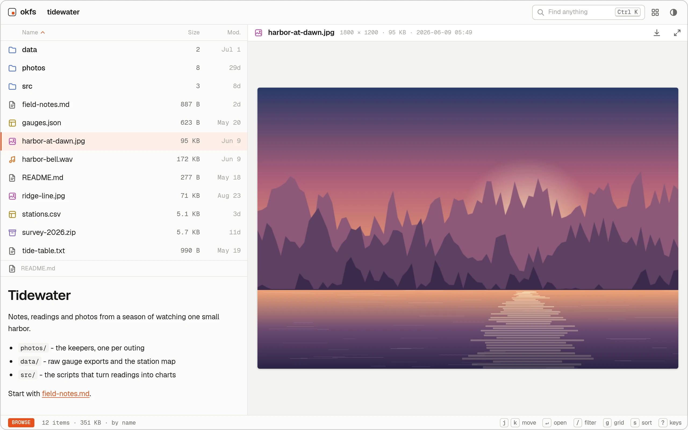
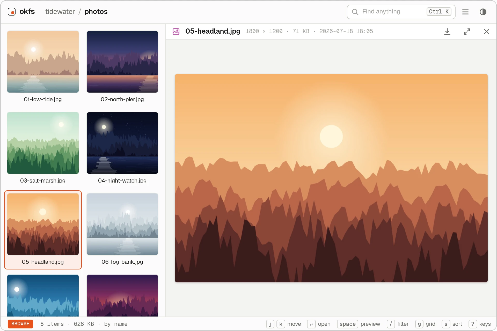
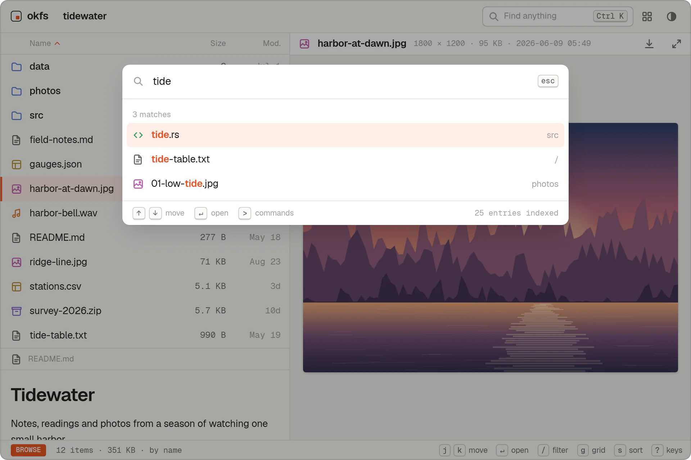
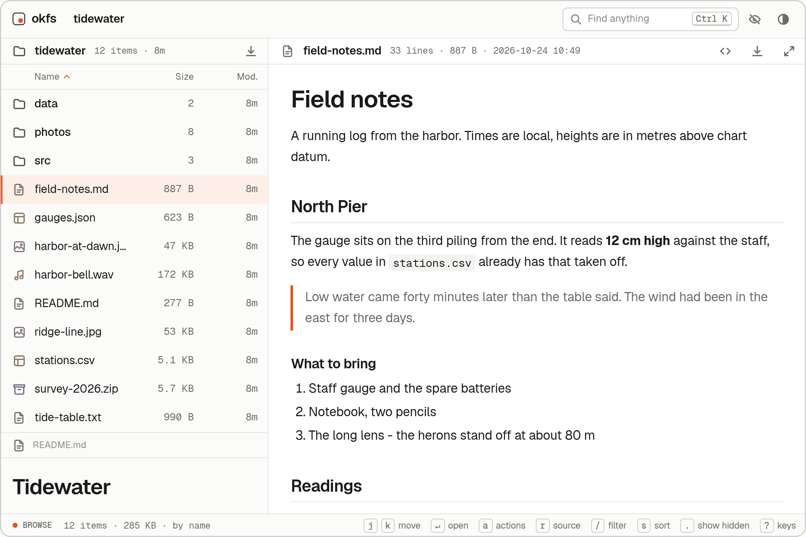
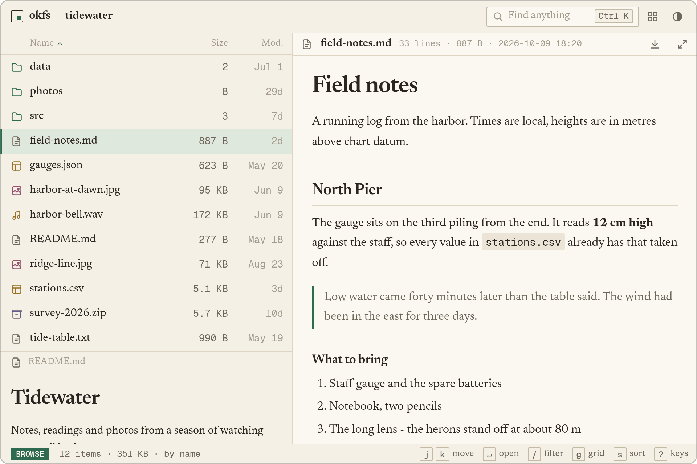
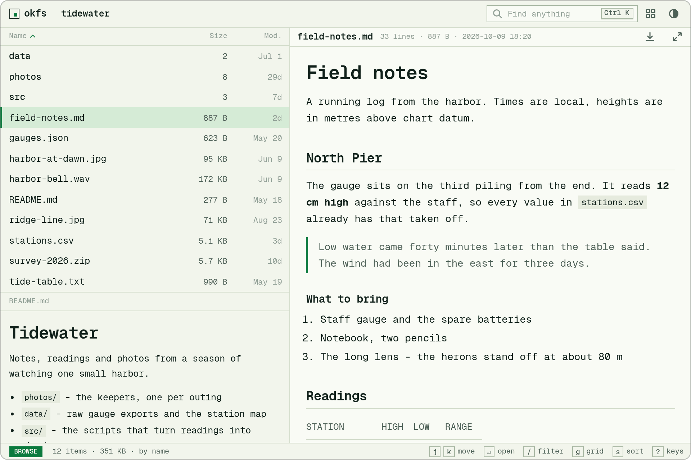
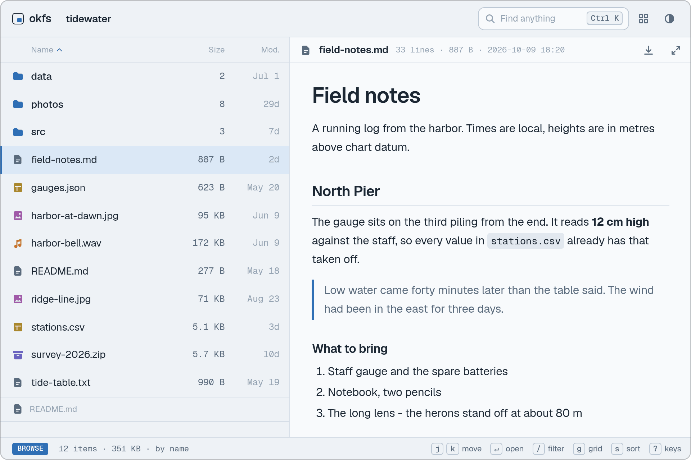
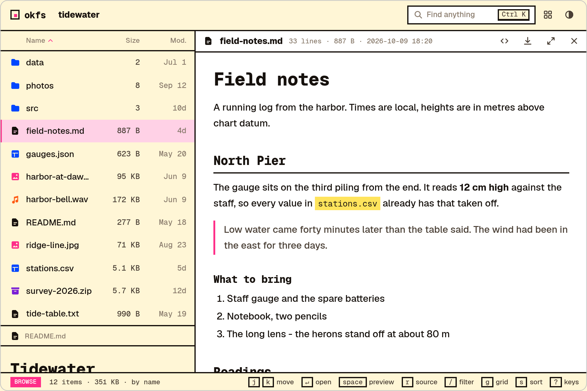

<h1 align="center">okfs</h1>

<p align="center">A web file browser. Run it in a folder and flip through every file inside.</p>

<p align="center">
  <picture><source media="(prefers-color-scheme: dark)" srcset="docs/screenshots/hero-dark.webp"></picture>
</p>

`okfs` stands for "ok file server". It is one small binary. The page is compiled into it, so there is nothing to install beside it and nothing is fetched from another site while it runs.

- A dense list on the left, the file under the cursor on the right. Hold `j` to flip through a folder.
- Previews for images, video, audio, PDF, Markdown, source code, CSV, JSON, zip files and HTML pages.
- A palette (`Ctrl K` or `Cmd K`) that finds any file in the whole tree.
- Themes: one CSS file each, five built in, light and dark.
- Read only. There is no upload, no delete, no editing and no accounts.

<p align="center">
  <picture><source media="(prefers-color-scheme: dark)" srcset="docs/screenshots/grid-dark.webp"></picture>
  <picture><source media="(prefers-color-scheme: dark)" srcset="docs/screenshots/palette-dark.webp"></picture>
</p>

## Install from source

With nix and nothing else installed, one command builds this checkout and puts `okfs` on your `PATH`:

```sh
nix develop -c cargo install --path . --locked    # installs to ~/.cargo/bin
```

Run it again after a pull or an edit to get the latest.

Without nix you need a Rust toolchain and [bun](https://bun.sh). Bun builds the page while cargo builds the binary.

```sh
cargo install --path .    # from a checkout of this repository
```

To build without installing, the nix dev shell has both:

```sh
nix develop
cargo build --release    # the binary is target/release/okfs
```

## Use

```sh
okfs                        # serve this folder at http://127.0.0.1:8080/
okfs ~/photos --port 9000   # another folder, another port
okfs --bind 0.0.0.0         # let other machines on the network in
```

A folder's `README.md` is shown under its listing.

<details>
<summary>All flags</summary>

| Flag | What it does |
| --- | --- |
| `[PATH]` | The folder to serve. Default: the current folder. |
| `-b`, `--bind <ADDR>` | Address to listen on. Default `127.0.0.1`. |
| `-p`, `--port <PORT>` | Port to listen on. Default `8080`. |
| `--index <FILE>` | Open a folder that holds a file of this name as that page: `--index index.html`. Off by default. See below. |
| `--theme <NAME\|FILE>` | Theme a new visitor starts in: a built-in name or a theme file. |
| `--css <FILE>` | Your own stylesheet, loaded after the theme. Class names are not a promise and may change. |
| `--header <FILE.md>` | A Markdown note shown above every folder. |
| `--title <TEXT>` | Name shown in the corner and the browser tab. Default `okfs`. |
| `--accent <COLOR>` | Accent color in every theme, as hex: `"#2d6a4f"`. |
| `-H`, `--hidden` | Show and serve dotfiles. They are left out by default. |
| `--allow-host <NAME>` | Also answer to this host name. Repeatable. See below. |

</details>

### Keys

| Key | Does |
| --- | --- |
| `j` `k`, arrows | Move down and up |
| `Enter` | Open the folder, or give the file the full width |
| `Backspace` | Up one folder |
| `/` | Filter this folder |
| `Ctrl K`, `Cmd K` | Find anything in the tree. Start with `>` for commands. |
| `g` | List or grid |
| `s` | Change the sort |
| `t` | Light or dark |
| `Esc` | Close the preview |
| `?` | Show the keys |

### A folder that is a small site

A folder is shown as its listing. With `--index`, a folder that holds a file of that name opens as that page, at the folder's own address, so a link to the folder is a link to the site:

```sh
okfs --index index.html
```

The page is shown the way any HTML file is: full width under the thin bar, sandboxed. A link in it to another folder opens that folder's index page too. Closing it shows the folder's listing with the page under the cursor. A folder of that name is not an index page. Neither is a file okfs does not serve: a dotfile without `--hidden`, or a link that leaves the served folder.

### Behind a proxy or a tunnel

While okfs listens on a loopback address it answers only to `localhost` and to plain addresses. This stops a hostile web page from reaching it by pointing a host name at your machine. If you put a proxy or a tunnel in front, name the host it uses:

```sh
okfs --allow-host files.example.com
```

## Themes

<table>
  <tr>
    <td width="50%" valign="top"><picture><source media="(prefers-color-scheme: dark)" srcset="docs/screenshots/theme-default-dark.png"></picture><br><b><code>default</code></b><br>The contract's own values.</td>
    <td width="50%" valign="top"><picture><source media="(prefers-color-scheme: dark)" srcset="docs/screenshots/theme-paper-dark.png"></picture><br><b><code>paper</code></b><br>Warm, bookish, serif. Flat: no shadows, almost no radius.</td>
  </tr>
  <tr>
    <td width="50%" valign="top"><picture><source media="(prefers-color-scheme: dark)" srcset="docs/screenshots/theme-terminal-dark.png"></picture><br><b><code>terminal</code></b><br>Monospace everywhere, square corners, tight rows, no icons.</td>
    <td width="50%" valign="top"><picture><source media="(prefers-color-scheme: dark)" srcset="docs/screenshots/theme-fjord-dark.png"></picture><br><b><code>fjord</code></b><br>Cool and roomy: blue-grey surfaces, soft corners, solid icons.</td>
  </tr>
  <tr>
    <td width="50%" valign="top"><picture><source media="(prefers-color-scheme: dark)" srcset="docs/screenshots/theme-riso-dark.png"></picture><br><b><code>riso</code></b><br>Deliberately loud. Two-ink print: thick outlines, hard offset shadows, capitals.</td>
    <td width="50%" align="center"><b>yours</b><br>One CSS file. See <a href="#write-one">Write one</a>.</td>
  </tr>
</table>

A theme is one CSS file that sets tokens and nothing else. The contract is [`ui/src/styles/tokens.css`](ui/src/styles/tokens.css): 42 tokens for color, type, shape and icons. The built-in themes are in [`themes/`](themes).

```sh
okfs theme list              # the built-in themes
okfs --theme paper           # start in one
okfs --theme ./mine.css      # start in your own
okfs theme check ./mine.css  # check a file against the contract
```

Visitors can switch between the built-in themes in the page. The choice is remembered per browser.

### Write one

Copy a file from `themes/`, change the values and run `okfs --theme ./mine.css` to see it on your own files. Edits show on the next page load.

```css
/* @name Mine  @author you  @version 1
   One line about it. */
:root {
  --accent: #2d6a4f;
  --accent-fg: #ffffff;
  --radius: 2px;
  --font-ui: "Newsreader", Georgia, serif;
}
:root[data-scheme="dark"] {
  --accent: #8fc7a6;
  --accent-fg: #14211a;
}
```

<details>
<summary>The rules and bounds a theme file must keep</summary>

The rules, all enforced by `okfs theme check` and again when okfs loads a theme file:

- The file starts with a comment that names the theme with `@name`.
- Exactly two blocks, in this order: `:root` and `:root[data-scheme="dark"]`. Either may be empty. No other selector and no at-rule.
- Only the 42 tokens may be set. A token left out keeps its default.
- Nothing may be loaded: no `url()`, no `@import`, no `@font-face`. Fonts are the three bundled families (`Geist`, `Geist Mono`, `Newsreader`) or ones on the visitor's system.
- Bounds:

  | Token | Allowed |
  | --- | --- |
  | `--text` | 12px to 16px |
  | `--density` | 0.8 to 1.3 |
  | `--radius` | 0 to 12px |
  | `--radius-lg` | 0 to 20px |
  | `--line-w` | 1px to 2px |
  | `--icon-stroke` | 1 to 2 |
  | `--weight`, `--weight-strong` | 100 to 900 |
  | `--tracking` | -0.05em to 0.15em, or -1px to 2px |
  | `--icon-set` | `line`, `solid` or `none` |
  | `--label-case` | `none` or `uppercase` |

- `--bg`, `--surface`, `--fg`, `--accent` and `--accent-fg` are opaque hex or `rgb()` colors, so contrast can be checked. In both schemes `--fg` needs at least 4.5:1 against `--bg` and `--surface`, and `--accent-fg` at least 3:1 against `--accent`.

</details>

To add a theme to okfs itself, open a pull request that adds one file to `themes/`.

## What is safe to serve

- No path leaves the served folder. Symbolic links that point outside it are not followed and not listed.
- Nothing is written into the served folder. Thumbnails are cached in your cache folder (`$XDG_CACHE_HOME/okfs` on Linux).
- HTML and SVG files from the served folder are always sent sandboxed. They run in an origin of their own, in the preview and when opened directly, so a served page can never act as okfs. One effect: such a page cannot `fetch` its neighbours or load module scripts and web fonts from the folder.
- okfs has no accounts. Anyone who can reach the address can read every file in the folder.

## Develop

```sh
nix develop
cargo test                                  # server behavior and the theme checker
cargo clippy --all-targets -- -D warnings
cargo fmt --check
cd ui && bun run check                      # type check the page
```

The server is Rust (axum, tokio). The page is TypeScript and Preact in `ui/`, built by `build.rs` into the binary. To work on the page without rebuilding the binary each time, run a debug build with `OKFS_UI_DIR=ui/dist` and rebuild the page with `cd ui && bun run build`.

## License

okfs is released under the MIT License. See `LICENSE`.

Geist, Geist Mono and Newsreader are bundled under the SIL Open Font License 1.1.
