# Themes

<table>
  <tr>
    <td width="50%" valign="top"><picture><source media="(prefers-color-scheme: dark)" srcset="screenshots/theme-default-dark.png">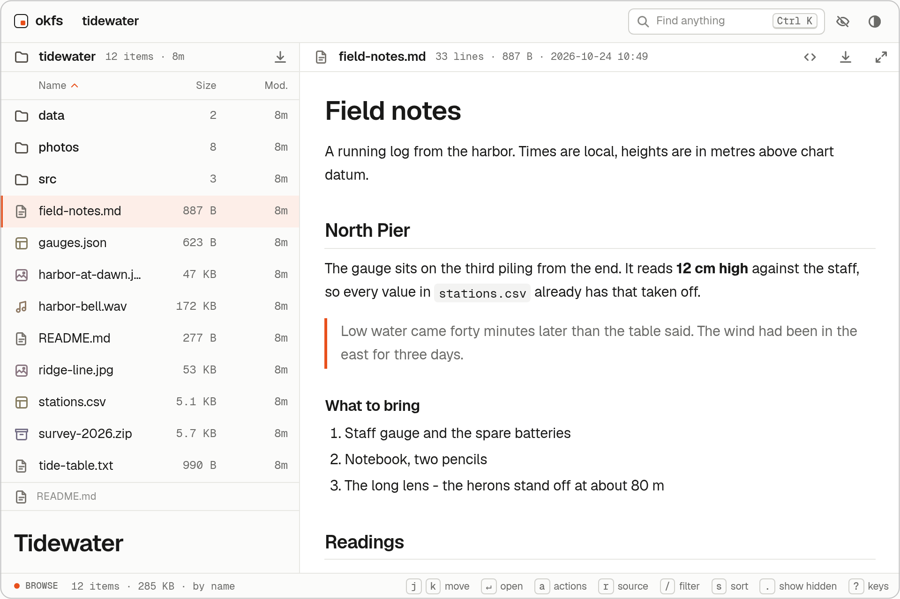</picture><br><b><code>default</code></b><br>The contract's own values: warm greys and one orange.</td>
    <td width="50%" valign="top"><picture><source media="(prefers-color-scheme: dark)" srcset="screenshots/theme-tokyo-night-dark.png">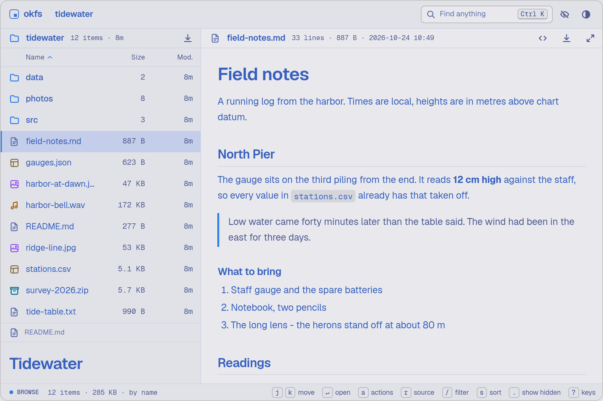</picture><br><b><code>tokyo-night</code></b><br>Tokyo's neon at night, a crisp blue by day.</td>
  </tr>
  <tr>
    <td width="50%" valign="top"><picture><source media="(prefers-color-scheme: dark)" srcset="screenshots/theme-catppuccin-dark.png">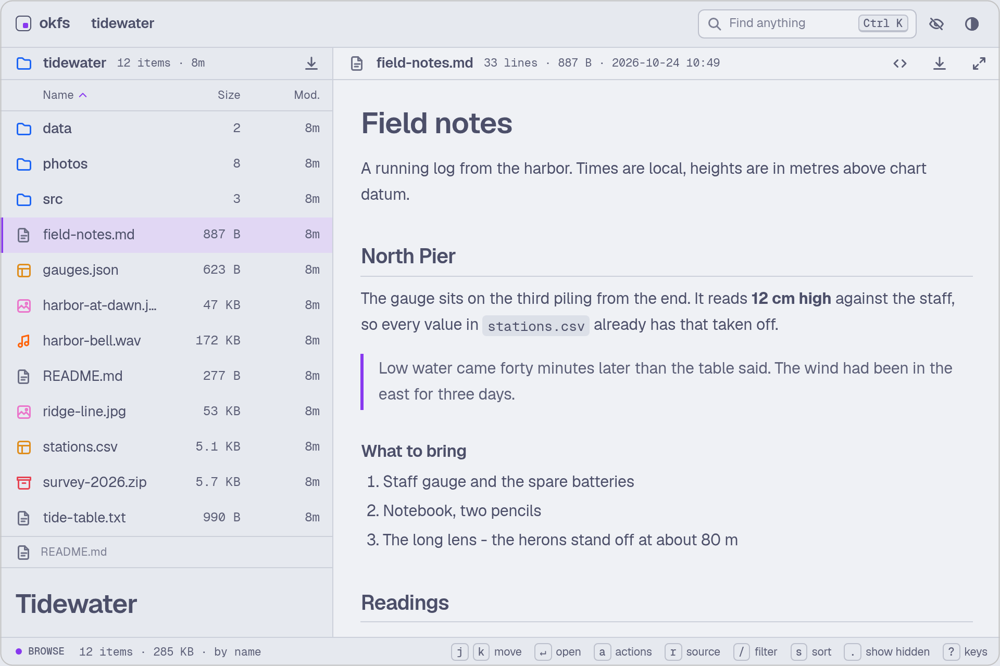</picture><br><b><code>catppuccin</code></b><br>Pastels: Latte by day, Mocha by night.</td>
    <td width="50%" valign="top"><picture><source media="(prefers-color-scheme: dark)" srcset="screenshots/theme-rose-pine-dark.png">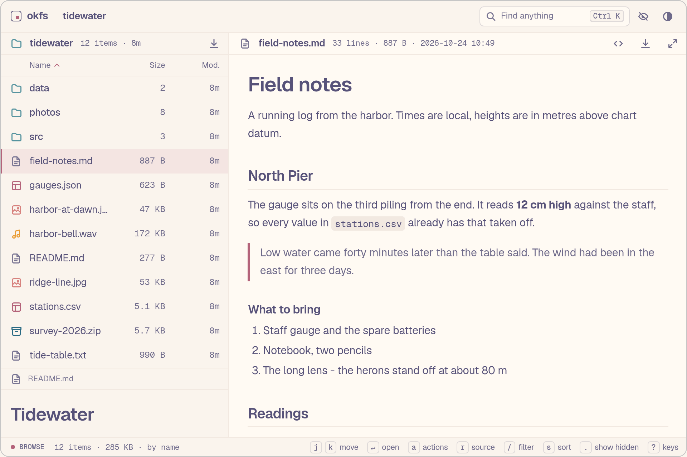</picture><br><b><code>rose-pine</code></b><br>Soft rose and pine, Dawn and Main.</td>
  </tr>
  <tr>
    <td width="50%" valign="top"><picture><source media="(prefers-color-scheme: dark)" srcset="screenshots/theme-gruvbox-dark.png">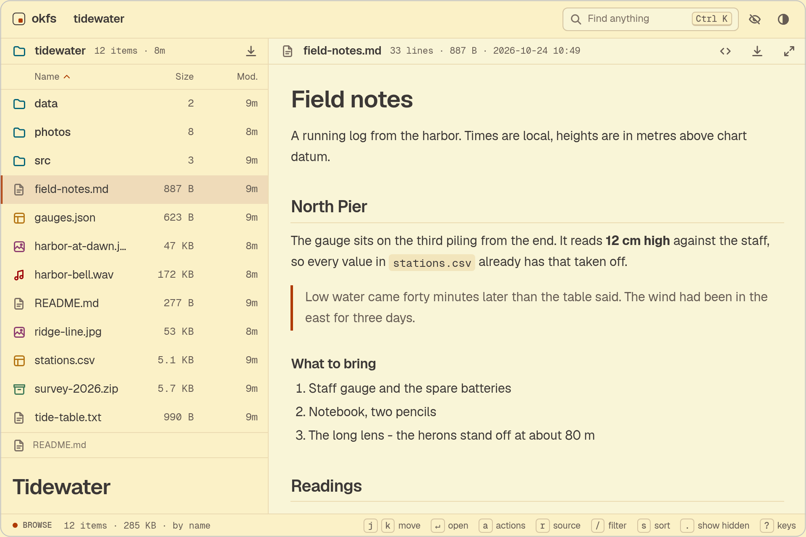</picture><br><b><code>gruvbox</code></b><br>Retro groove: warm, high-contrast browns.</td>
    <td width="50%" valign="top"><picture><source media="(prefers-color-scheme: dark)" srcset="screenshots/theme-kanagawa-dark.png">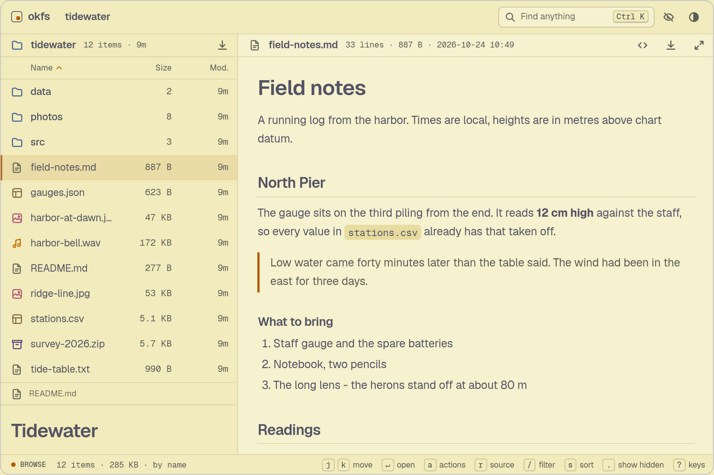</picture><br><b><code>kanagawa</code></b><br>After Hokusai's Great Wave: ink, gold and indigo.</td>
  </tr>
  <tr>
    <td width="50%" valign="top"><picture><source media="(prefers-color-scheme: dark)" srcset="screenshots/theme-everforest-dark.png">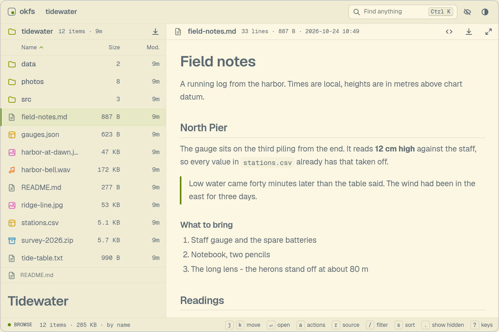</picture><br><b><code>everforest</code></b><br>Calm, green and easy on the eyes.</td>
    <td width="50%" valign="top"><picture><source media="(prefers-color-scheme: dark)" srcset="screenshots/theme-nord-dark.png">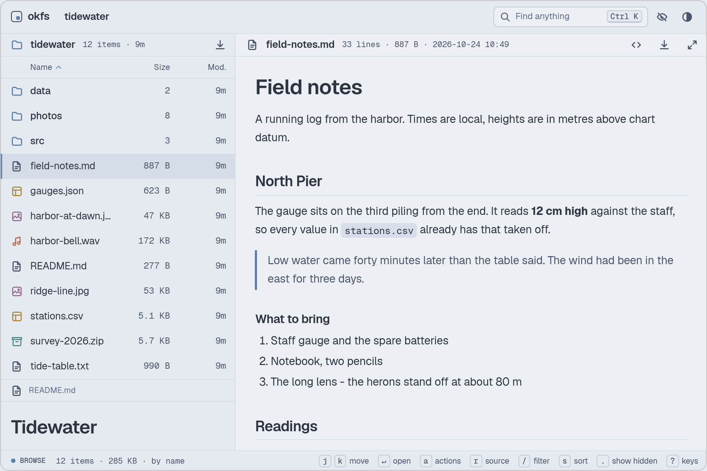</picture><br><b><code>nord</code></b><br>Arctic blue-greys: Snow Storm and Polar Night.</td>
  </tr>
  <tr>
    <td width="50%" valign="top"><picture><source media="(prefers-color-scheme: dark)" srcset="screenshots/theme-solarized-dark.png">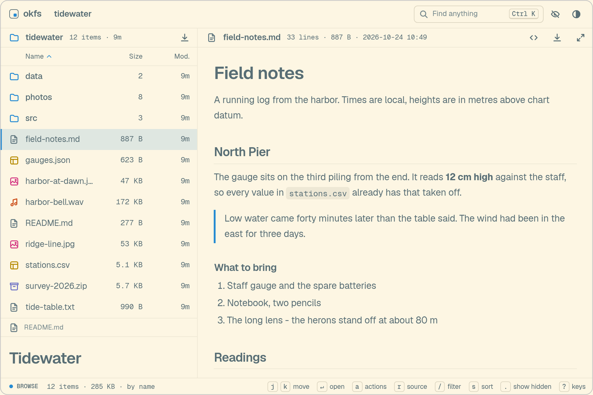</picture><br><b><code>solarized</code></b><br>The classic, with one blue accent in both schemes.</td>
    <td width="50%" valign="top"><picture><source media="(prefers-color-scheme: dark)" srcset="screenshots/theme-one-dark.png">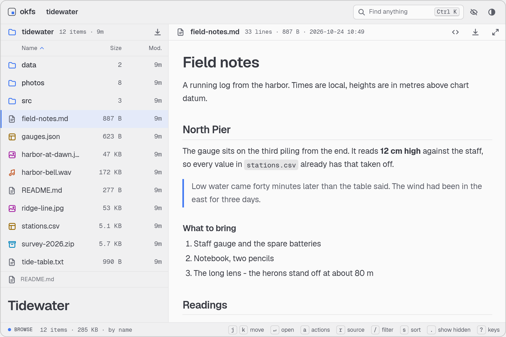</picture><br><b><code>one</code></b><br>One Light and One Dark, from the Atom editor.</td>
  </tr>
  <tr>
    <td width="50%" valign="top"><picture><source media="(prefers-color-scheme: dark)" srcset="screenshots/theme-flexoki-dark.png">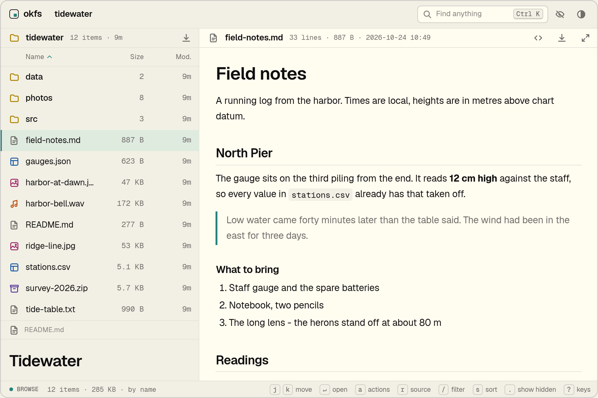</picture><br><b><code>flexoki</code></b><br>Inky, paper-warm colors for prose and code.</td>
    <td width="50%" align="center"><b>yours</b><br>One CSS file. See <a href="#write-one">Write one</a>.</td>
  </tr>
</table>

A theme is one CSS file that sets tokens and nothing else. The contract is [`ui/src/styles/tokens.css`](../ui/src/styles/tokens.css): 42 tokens for color, type, shape and icons. The built-in themes are in [`themes/`](../themes).

```sh
okfs theme list              # the built-in themes
okfs --theme gruvbox         # start in one
okfs --theme ./mine.css      # start in your own
okfs theme check ./mine.css  # check a file against the contract
```

Visitors can switch between the built-in themes in the page, with `Theme` in the palette. Moving over a theme shows it and `Enter` chooses it. The choice is remembered per browser.

## Write one

Copy a file from `themes/`, change the values and run `okfs --theme ./mine.css` to see it on your own files. Edits show on the next page load.

```css
/* @name Mine  @author you  @version 1
   One line about it. */
:root {
  --accent: #2d6a4f;
  --accent-fg: #ffffff;
  --radius: 2px;
  --font-ui: "Newsreader", Georgia, serif;
}
:root[data-scheme="dark"] {
  --accent: #8fc7a6;
  --accent-fg: #14211a;
}
```

<details>
<summary>The rules and bounds a theme file must keep</summary>

The rules, all enforced by `okfs theme check` and again when okfs loads a theme file:

- The file starts with a comment that names the theme with `@name`.
- Exactly two blocks, in this order: `:root` and `:root[data-scheme="dark"]`. Either may be empty. No other selector and no at-rule.
- Only the 42 tokens may be set. A token left out keeps its default.
- Nothing may be loaded: no `url()`, no `@import`, no `@font-face`. Fonts are the three bundled families (`Geist`, `Geist Mono`, `Newsreader`) or ones on the visitor's system.
- Bounds:

  | Token | Allowed |
  | --- | --- |
  | `--text` | 12px to 16px |
  | `--density` | 0.8 to 1.3 |
  | `--radius` | 0 to 12px |
  | `--radius-lg` | 0 to 20px |
  | `--line-w` | 1px to 2px |
  | `--icon-stroke` | 1 to 2 |
  | `--weight`, `--weight-strong` | 100 to 900 |
  | `--tracking` | -0.05em to 0.15em, or -1px to 2px |
  | `--icon-set` | `line`, `solid` or `none` |
  | `--label-case` | `none` or `uppercase` |

- `--bg`, `--surface`, `--fg`, `--faint`, `--accent` and `--accent-fg` are opaque hex or `rgb()` colors, so contrast can be checked. In both schemes `--fg` needs at least 4.5:1 against `--bg` and `--surface`, `--faint` at least 3:1 against `--bg`, and `--accent-fg` at least 3:1 against `--accent`.

</details>

To add a theme to okfs itself, open a pull request that adds one file to `themes/`.
